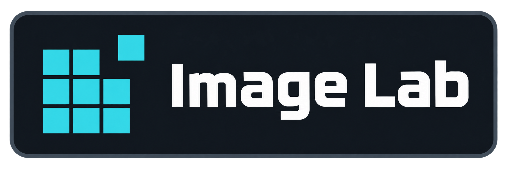
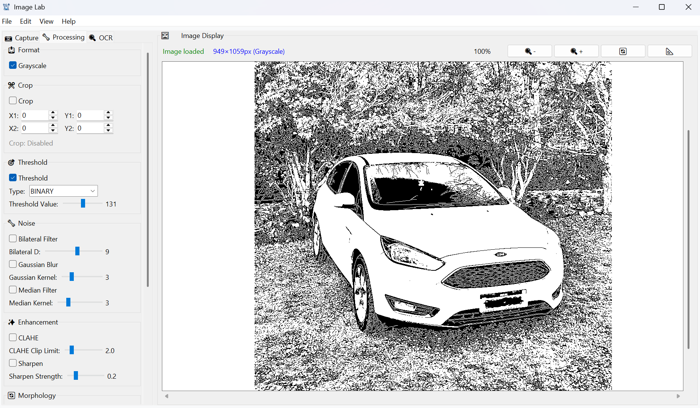

<p align="center">
  
</p>

<p align="center">
  Desktop app for tuning image preprocessing and comparing how OCR engines read the result.
</p>

<p align="center">
  
</p>

## Preview



## Features

- Live preview of a preprocessing pipeline: crop, resize, deskew, threshold, noise filters, enhancement, and morphology.
- Four OCR engines on the same image: PaddleOCR, Tesseract, EasyOCR, and RapidOCR.
- Images from a file, the clipboard, a screen capture, or a camera.
- Settings saved and loaded as JSON presets.

## Setup

Requirements:

- Python 3.13 or newer
- [Tesseract OCR](https://github.com/tesseract-ocr/tesseract) installed on the system, for the Tesseract engine; the `pytesseract` package alone is not enough

Steps:

1. Clone the repository.

   ```bash
   git clone https://github.com/kodezy/image-lab.git
   cd image-lab
   ```

2. Create and activate a virtual environment.

   ```bash
   python -m venv .venv
   source .venv/bin/activate
   ```

   On Windows, activate it with `.venv\Scripts\activate`.

3. Install the app.

   ```bash
   pip install -e .
   ```

   This also installs the OCR engines (PaddlePaddle, EasyOCR, ONNX Runtime), so the download is large.

## Usage

Start the app:

```bash
image-lab
```

1. Load an image from the **File** menu, or capture one in the **Capture** tab.
2. Adjust the pipeline in the **Processing** tab and watch the preview.
3. Pick an engine and run it in the **OCR** tab.
4. Save the result with **File → Save Image**, or the settings with **File → Save Config**.

The first run of each OCR engine may download its models.

**Help → Keyboard Shortcuts** lists the shortcuts.

## Limits

- Camera capture uses the DirectShow backend, so it works only on Windows. Screen capture works on every platform.

## License

[MIT](LICENSE)
